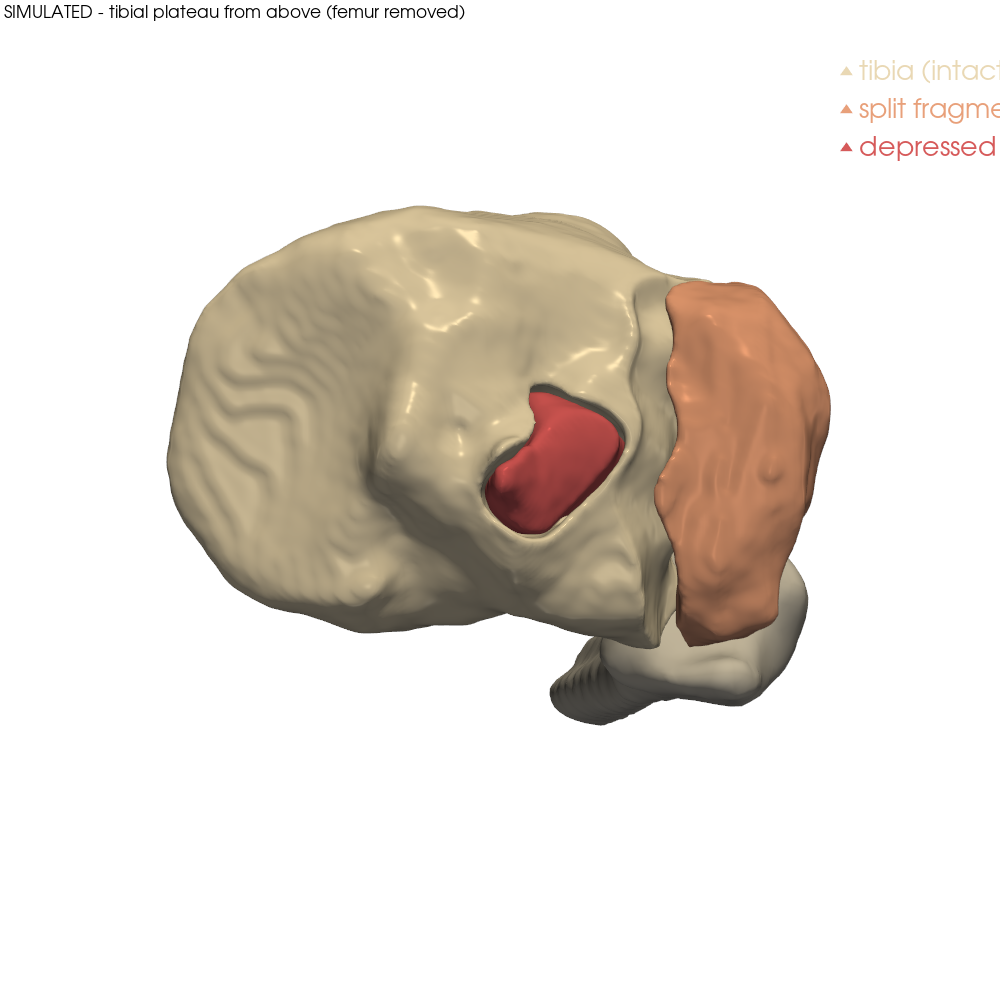

# CT → 3D → 3D print: knee and fracture models

Python tools for opening open-access CT datasets, rebuilding bones in 3D, visualising
fractures, simulating a tibial plateau fracture, and exporting watertight STL files
ready for 3D printing.



> **Not for clinical use.** This is an educational/research project. The fractured knee
> model is **simulated** (a real intact knee, broken programmatically). It is not
> patient data and not a medical device.

## What's here

| Folder | Contents |
|---|---|
| `scripts/` | All the Python tools (see below) |
| `download/` | Scripts that fetch the raw datasets (~22 GB, not stored in this repo) |
| `outputs/` | Rendered images and STL meshes produced by the scripts |
| `print_ready/` | Repaired, watertight STLs placed on the build plate, ready for a slicer |

### Scripts

| Script | What it does |
|---|---|
| `open_knee_ct.py` | Loads a DICOM CT series with pydicom, prints the scan details, saves orthogonal views and a downsampled NIfTI volume |
| `reconstruct_3d.py` | Threshold + morphology + marching cubes → one STL per bone, plus renders |
| `view_fracatlas.py` | FracAtlas X-rays with fracture outlines; grid of limbs with surgical hardware |
| `view_platif.py` | PlaTiF tibial plateau fractures: one example per Schatzker type, per-patient views |
| `view_pengwin.py` | PENGWIN fractured-pelvis CT: label overlays, 3D fragment render, STL per fragment |
| `simulate_knee_fracture.py` | Cuts and displaces a Schatzker II fracture (lateral split + depression) on a real knee from VSDFullBodyBoneModels |
| `make_printable.py` | Repairs STLs (watertight/manifold), simplifies, places on the bed, optional scaling, and can fuse fragments into one solid |

## Quick start (Ubuntu / WSL)

```bash
python3 -m venv ~/knee_ct_venv && source ~/knee_ct_venv/bin/activate
pip install -r requirements.txt

# 1. Get data (pick what you need)
bash download/download_knee_ct.sh            # Leeds cadaveric knee CT, ~8.2 GB
bash download/download_fractures.sh all      # FracAtlas + PlaTiF + PENGWIN, ~14 GB
bash download/download_vsd_bones.sh          # VSD bone meshes, 0.18 GB

# 2. Open a CT and rebuild it in 3D
python scripts/open_knee_ct.py ~/knee_ct_datasets/leeds_LTKN7607/ct/LTKN7607_CT_intact out/LTKN7607 4
python scripts/reconstruct_3d.py out/LTKN7607/volume_ds4.nii.gz out/LTKN7607/3d     # threshold default 750

# 3. Fracture datasets
python scripts/view_fracatlas.py ~/fracture_datasets/fracatlas/extracted/FracAtlas out/fracatlas leg 12
python scripts/view_platif.py   ~/fracture_datasets/platif/extracted out/platif          # add a patient id for one patient
python scripts/view_pengwin.py  ~/fracture_datasets/pengwin_ct/images/039.mha ~/fracture_datasets/pengwin_ct/labels/039.mha out/pengwin/039

# 4. Simulated fractured knee
VSD=$(ls -d ~/knee_ct_datasets/vsd_bone_models/extracted/*/Bones)
python scripts/simulate_knee_fracture.py $VSD/002.mat out/simulated_knee R ~/fracture_datasets/platif/extracted

# 5. Make it printable (life size; add --scale 0.5 for half size)
S=out/simulated_knee
python scripts/make_printable.py out/print $S/tibia_1_tibia.stl $S/tibia_2_split.stl $S/tibia_3_depressed.stl \
  $S/femur.stl $S/patella.stl $S/fibula.stl \
  --fuse tibia_fractured_onepiece $S/tibia_1_tibia.stl $S/tibia_2_split.stl $S/tibia_3_depressed.stl
```

Interactive 3D window: `python -c "import pyvista as pv; pv.read('print_ready/fractured_knee/tibia_fractured_onepiece.stl').plot()"`
(on WSL, `unset LIBGL_ALWAYS_INDIRECT` if you get "Cannot create GLX context").

## 3D printing

`print_ready/fractured_knee/` (life size) and `print_ready/fractured_knee_half/`:

| File | Size (mm, life size) | Notes |
|---|---|---|
| `tibia_fractured_onepiece.stl` | 77 × 54 × 130 | Fragments fused into one solid; cracks and the depression stay visible. Easiest print |
| `tibia_1_tibia.stl`, `tibia_2_split.stl`, `tibia_3_depressed.stl` | 67×54×130, 21×43×25, 17×16×16 | Separate pieces, for printing fragments in another colour and gluing |
| `femur.stl`, `patella.stl`, `fibula.stl` | 78×66×121, 41×23×40, 30×33×101 | Rest of the knee; cut ends capped flat as bases |

All parts are checked watertight and manifold. Suggested: PLA, 0.2 mm layers, 15–20 % infill,
3 walls, supports on (the tibial plateau overhangs its shaft).

## Notes and limitations

- The Leeds knee CT is a Scanco XtremeCT scan (82 µm voxels, 1358×1358×1649). Full
  resolution is 6.1 GB in memory, so `open_knee_ct.py` downsamples (default ×4).
- `reconstruct_3d.py`'s threshold (750) was tuned on the Leeds knee. Its automatic Otsu
  threshold picked up a noisy soft-tissue band at the edge of the scan.
- The simulated fracture uses smooth curved cut surfaces with mild random roughness. Real
  fractures are messier and often have more fragments. Compare `outputs/fractures/simulated_knee/section_vs_real.png`.

## Data sources and licences

The raw data is **not** in this repo; the `download/` scripts fetch it from the original sources.
Files in `outputs/` and `print_ready/` are derived from these datasets and keep their licences:

| Dataset | Licence | Used for | Reference |
|---|---|---|---|
| University of Leeds IMBE Knee Dataset | CC BY 4.0 | `outputs/knee_ct/` | University of Leeds, doi:10.5518/826 |
| VSDFullBodyBoneModels (Fischer) | **CC BY-NC-SA 4.0** | `outputs/fractures/simulated_knee/`, `print_ready/` | doi:10.5281/zenodo.8316967; Fischer et al., *Sci Data* 2023 |
| PlaTiF tibial plateau fractures | CC BY 4.0 | `outputs/fractures/platif/` | doi:10.5281/zenodo.18007397 |
| FracAtlas | CC BY 4.0 | `outputs/fractures/fracatlas/` | doi:10.6084/m9.figshare.22363012; *Sci Data* 2023 |
| PENGWIN Task 1 (pelvic fracture CT) | CC BY 4.0 | `outputs/fractures/pengwin/` | doi:10.5281/zenodo.10927452 |

Because the simulated knee and the print files are built from VSDFullBodyBoneModels meshes,
**they may only be used non-commercially and must be shared under CC BY-NC-SA 4.0** with attribution.
